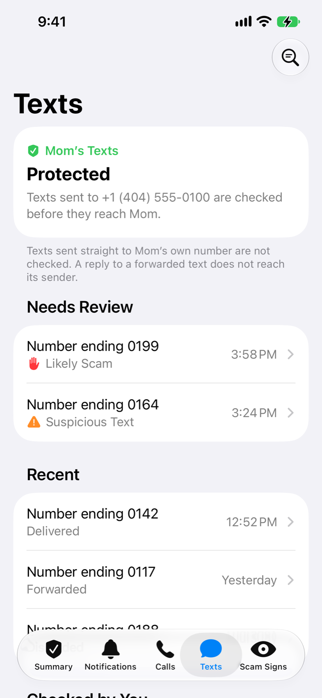
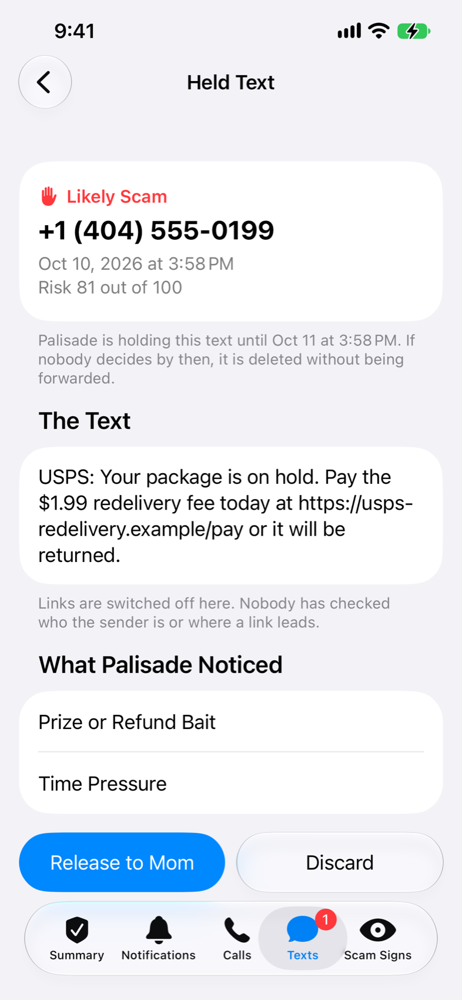
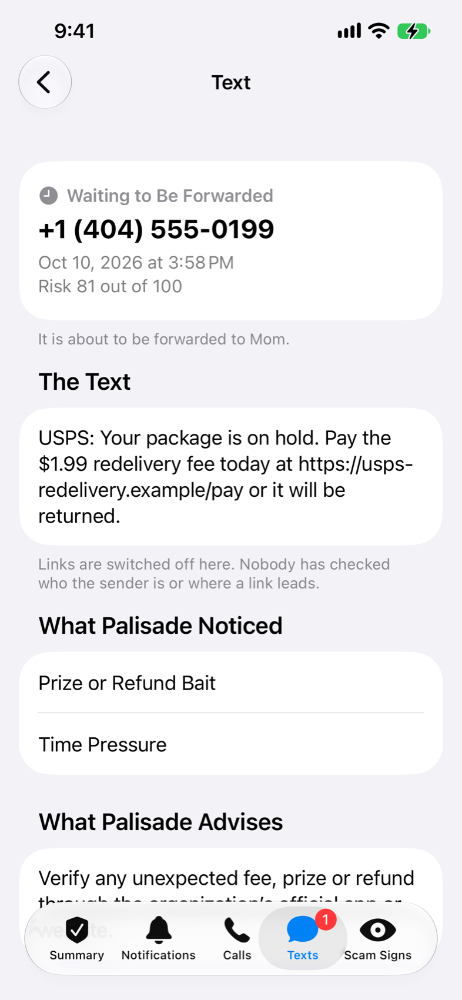
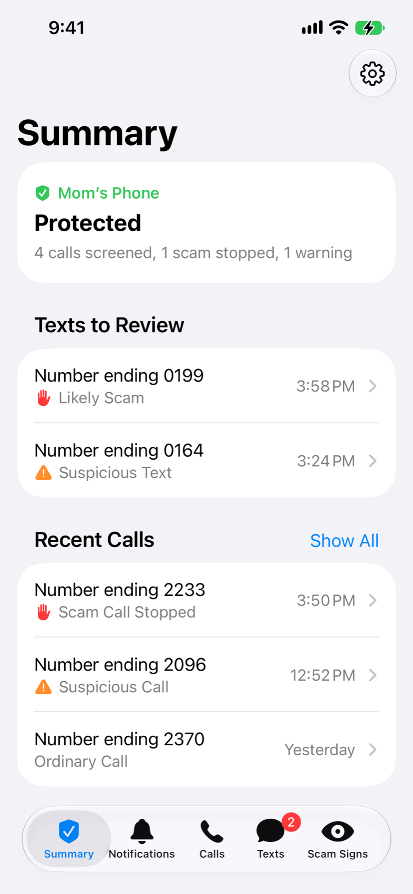
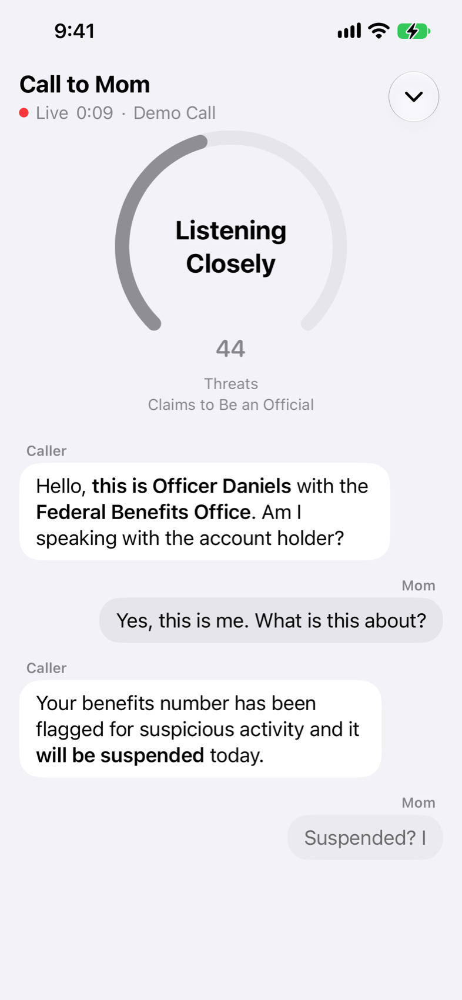

# Text gateway merge review — October 10, 2026

> **Written on the `Nabil-text` branch, before it was merged into main.** It is kept as
> the record of that review, and reads as it did then, product name included. Since
> (2026-10-10): the product is called Palisade; the screens described here were rebuilt in
> main's look, which settled the two points under "Remaining feedback" (the setup card is
> three lines now, and Discard is no longer tinted like Release) and they were checked in
> dark and at a large text size; the banner gave way to a count on the Texts tab, a buzz
> and a list on Summary; the pictures linked at the end were retaken from the app as it is
> now; and "Vultr deployment" means [deploy/README.md](../deploy/README.md), for the server
> main already runs on. The counts below are the branch's. `HANDOFF.md` has today's.

Local validation passes. Merge with forwarding disabled; enable live senior
forwarding only after the real Twilio/Photon exchange described below succeeds.
All messages and phone numbers in the screenshots are fake demo fixtures.
No real SMS, iMessage, phone call, or LLM request was made during this review.

## Results

| Check | Result |
| --- | --- |
| Full Python suite, including call and manual-check regressions | 208 passed |
| Gateway and manual-message subset | 58 passed |
| Spectrum worker tests and TypeScript build | 13 passed |
| Swift state-store regressions against actual store/models, mock transport | 5 passed |
| iOS Debug simulator build, Xcode 27 | Passed |
| Simulator visual checks, iPhone 16e / iOS 27, light appearance | Passed |
| Whitespace check | `git diff --check` clean |

The initial Python run had four localhost socket permission failures in existing
Deepgram tests. Running with localhost access resolved them; they were not app
failures. Swift observation macros and simulator access also needed execution
outside the sandbox.

## Fixes made during review

1. A message loaded in the pending/checking state was incorrectly remembered as
   already alerted. When analysis completed, its first held-message banner was
   suppressed. The store now remembers held records for replay suppression,
   while pending records remain eligible for their first review alert.
2. Common OTP advice such as “Never share this code with anyone” was incorrectly
   scored as a secrecy demand (55). A narrow text-only exception now gives the
   example a rules score of 0. Other scam instructions in the same message still
   match. The LLM receives the original, complete text; call scoring is unchanged.

Added regression coverage for delayed holds, duplicate banners, unread badges,
read-state persistence, historical replay, retaining active calls, OTP warning
variants, preserving other scam matches, and preventing a low LLM score from
overriding a high deterministic rule score.

## Behavior exercised

- Risk 29 queues; risk 30 holds. Appointment text queues and package-payment
  scam text holds. LLM failures and incomplete analysis never automatically forward.
- Signed Twilio ingress and callbacks, token checks, fixed destinations, ignored
  participant replies/echoes, and Spectrum's caregiver-only delivery role.
- Original text plus screening footer in fake Twilio sends, and the distinct
  caregiver-release footer. The service never truncates an oversized message.
- Atomic release/claim, repeated submissions and release decisions, crash/timeout
  recovery without automatic resend, and monotonic delivery callbacks.
- Encrypted temporary content, body-free summaries/events, expiration, restart
  recovery, discard, unsupported MMS holds, and old Photon-record migration.
- The simulator rendered the protected inbox, plain-text held message, review
  controls, and queued state. A release through the authenticated local API
  updated the visible review screen through the actual live feed. The delayed
  held-text banner and badge appeared on Home. A mock active call stayed visible
  when another held-text event arrived.

The simulator review was visual/API-driven; native release/discard taps were not
automated. Backend decisions were tested through the authenticated API.

## Remaining feedback

Regex alone has false positives and misses. A small illustrative spot-check is
below; this is not a detection-quality benchmark.

| Rules-only example | Risk / action |
| --- | --- |
| Appointment reminder | 0 / queued |
| Delivery tracking update | 0 / queued |
| OTP notice with “Never share this code with anyone” | 0 / queued after fix |
| Package-payment link plus urgency | 81 / held |
| Locked-account verification link plus urgency | 74 / held |
| Gift-card demand or request to share verification code | 65 / held |
| “I bought you a gift card for your birthday” | 40 / held: false positive |
| “Hi Mom, my phone broke. This is my new number. Can you send me $500?” | 0 / queued: rules miss |

Use regex plus the configured LLM for live screening. The LLM can raise risk but
cannot lower the rules' score, so it cannot resolve the birthday false positive;
caregiver review handles that case. Detection quality of the real model still
needs evaluation on a broader labeled set, especially family impersonation.

The Texts setup card occupies much of the first screen on the tested device.
Moving its longer explanation/privacy copy into an expandable section would
bring review items higher. Discard currently inherits the app's green tint;
an explicit destructive tint would distinguish it from Release more clearly.
These are UI polish items. Smaller devices, large text sizes, and the new text
screens in dark appearance were not tested in this review.

## Live acceptance still required

Follow [deployment setup](../deploy/README.md), starting with
`TEXT_FORWARDING_ENABLED=false`. Configure the actual protected Twilio number,
senior destination, caregiver's Photon user, backend tokens, and encryption key.
Validate real inbound SMS, Spectrum connectivity, and held-message review.
Then enable forwarding for a controlled test and confirm:

1. An appointment text reaches the senior with the sender/footer intact.
2. A scam stays off the senior's phone and produces a caregiver iMessage alert.
3. Caregiver `WHY` returns a fixed explanation, and an app release sends once.
4. Twilio callbacks update delivery status through the public HTTPS endpoint.

During the initial review, no deployment, remote configuration, merge, commit,
or staging was performed. Existing working changes were preserved.

## Revalidation after merging into Nabil-text

On October 10, `feature/photon-text-shield` was merged into `Nabil-text` in
commit `2a3d6e2`, preserving both branches' commits without conflicts. The merged
branch passed the full 208 Python tests, 13 Spectrum tests with its TypeScript
build, five Swift state-store checks, and the iOS Debug simulator build.

Additional rules-only spot-checks on the merged source produced: appointment
and OTP privacy notices 0/queued, package-payment scam 81/held, locked-account
phishing 74/held, and OTP-sharing request 65/held. The mock delivery pipeline
confirmed held messages are not sent before release and repeated release or
ingress does not create a second delivery.

The 11,424 generated files under `photon/node_modules` and `photon/dist` from
the earlier Nabil-text commit were removed from Git tracking. Local copies were
retained, along with the source, package manifest, and lockfile. No history was
rewritten. The merge and cleanup are local; no GitHub push or deployment was
performed. All tests used mock transports, and the live acceptance checks and
regex limitations above still apply.

## Screenshots

| Protected inbox | Held review | Released and queued |
| --- | --- | --- |
|  |  |  |

| Live alert and badge | Active call remains visible |
| --- | --- |
|  |  |

## Repeat local checks

```bash
.venv/bin/python -m pytest -q
npm --prefix photon test
DEVELOPER_DIR=/Applications/Xcode.app/Contents/Developer bash tools/test_ios_gateway.sh
```

For isolated simulator fixtures, run `.venv/bin/python tools/demo_gateway.py`,
then launch the Debug app with `-serverURL http://127.0.0.1:8877`
`-accessToken demo-caregiver -tab texts`. Add `-gatewayMessageID demo_held` to
open the review screen directly. This demo keeps forwarding disabled.
