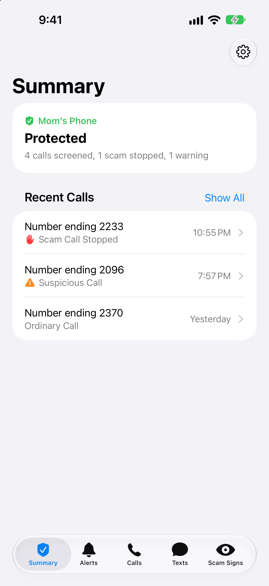
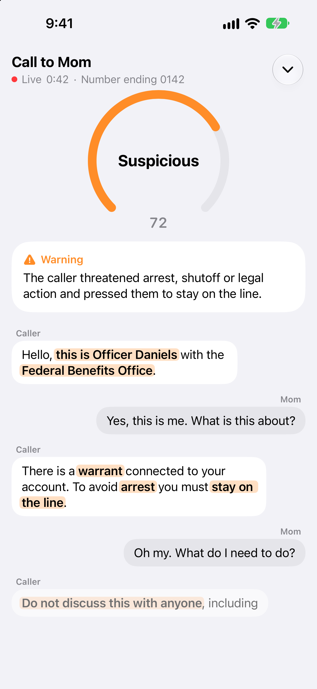
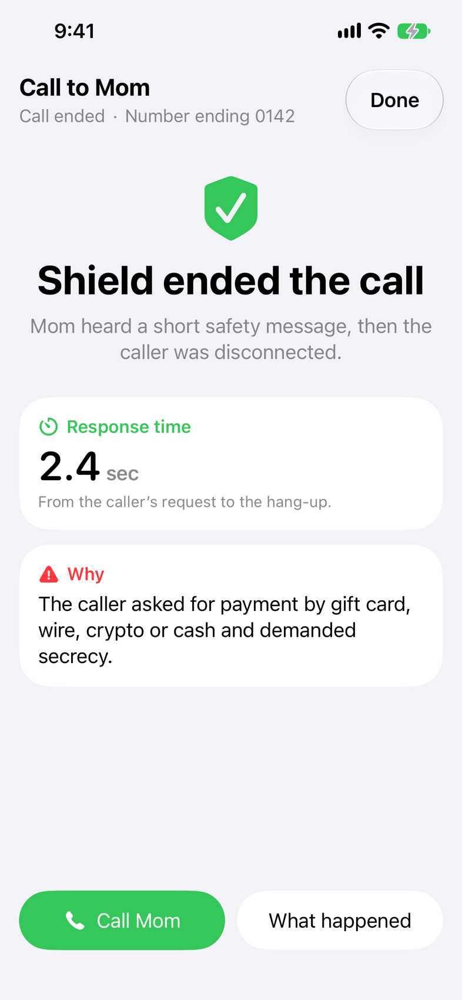
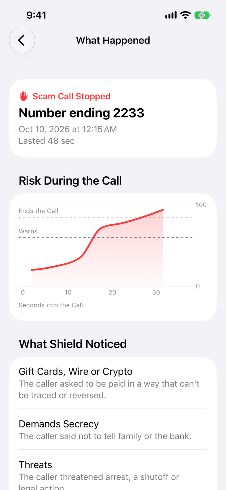

# Shield for iPhone

The **Texts** tab now supports the Twilio protected-number gateway: held texts,
private review, Release/Discard, delivery status, foreground banners, and unread
warnings. Enter the Vultr HTTPS URL and caregiver access token in Settings.
Closed-app warnings arrive through caregiver iMessage rather than native push.
Twilio forwards approved texts to the senior's normal Messages app with the
original sender and screening footer. Photon is the caregiver's iMessage agent;
its shared line is sufficient. Replies to forwarded SMS are not relayed.
See [deployment setup](../deploy/README.md) for service configuration and
temporary encrypted text storage. The existing manual paste checker remains
available beneath the protected inbox.

The [October 10 text-feature review](../docs/text-feature-review.md) includes
test results, remaining live acceptance checks, and simulator screenshots.
Run the focused gateway state-store regressions with
`DEVELOPER_DIR=/Applications/Xcode.app/Contents/Developer bash tools/test_ios_gateway.sh`.
These use the real Swift store/models and an in-memory transport; no texts are sent.

The caregiver's app. It shows the call in progress (risk dial, warning signs, live
transcript), takes over the screen when Shield ends a scam call, and keeps a list of
recent calls. The protected person needs no app at all.

It is a SwiftUI app for iOS 17 and later with no third-party dependencies. It reads the
Shield server's `GET /events` feed and `GET /calls` list.

## Status

- Builds with Xcode 27 for the simulator and for a device. The project file was written
  by hand and Xcode takes it as is.
- Run in the iPhone 17 simulator (iOS 27) against a Shield server playing demo calls, on
  2026-10-07 and again on 2026-10-08: Home with real call history, a scam call from first
  word to "Shield ended the call", the summary, Settings, the demo menu, an ordinary
  call that closes by itself, hiding and reopening a live call, and dark mode.
- Restyled on 2026-10-08 to the system's own look (grouped backgrounds, system type,
  cards at the system's corner radius), then redrawn the way Health draws its cards:
  black and gray text, the system's green, orange and red, and color used once per
  card, on a small label. No tinted boxes, pills or icons on colored discs.
- The same day it gained a "Call" button on Shield's warning and the caller's flagged
  phrases marked in the transcript.
- Settings has an Appearance choice: Automatic (follow the phone), Light or Dark.
- Looked at on 2026-10-08 with sample data: the "Ringing" state, a call that ends after
  a warning with no hang-up, and an accessibility text size. The layouts hold; at that
  text size the header's status line is cut short.
- **Not yet installed on a real iPhone.** That needs an Apple ID in Xcode; see below.
- Not yet looked at: smaller iPhones.

## Screens

Home also opens **Text messages**: paste a text to check it, or review results for
texts received by the Shield Twilio number. The screen receives result updates
through the existing event feed and refreshes from `GET /messages`. Message bodies
are not kept in history. This version does not read the personal phone’s Messages
inbox or install a Message Filter extension; see the backend README for SMS setup.

From the iPhone 17 simulator, with sample data.

| Home | Call in progress | Shield ended the call | What happened |
|---|---|---|---|
|  |  |  |  |

Dark mode: [screens/live-call-dark.png](screens/live-call-dark.png).

The "Call" button only appears once the protected person's phone number is in the app's
Settings. In the transcript, the caller's words that matched one of Shield's rules are
set in bold, and highlighted once the call looks suspicious. A demo call says "Demo
call" wherever a real call shows the caller's number.

Recent calls are listed under the day they came in. Each row leads with the caller's
number, masked by the server to its last four digits, and says what came of the call
under it.

## Run it in the simulator

1. Install Xcode from the Mac App Store. Installing it is not enough: it also needs its
   system components and the iOS simulator (an 8 GB download). Open Xcode once and
   accept both, or do it from a terminal:
   ```bash
   sudo xcode-select -s /Applications/Xcode.app/Contents/Developer
   sudo xcodebuild -license accept
   xcodebuild -runFirstLaunch        # asks for your Mac password
   xcodebuild -downloadPlatform iOS
   ```
2. Start the server with demo calls allowed (from the repo root):
   ```bash
   DEMO_MODE=true uvicorn main:app --port 8000 --timeout-graceful-shutdown 2
   ```
   A server that was already running before `DEMO_MODE` was set has to be restarted,
   or the app shows no play button.
3. Open `ios/Shield.xcodeproj`, pick an iPhone simulator, press Run.
4. The app connects to `http://localhost:8000` by default. Tap the play button at the
   top of Home and pick a scam call. The call screen opens by itself.

To point the app at another server without touching Settings, pass launch arguments:
`-serverURL http://localhost:8001`. `-seniorPhone +14045550100` does the same for the
phone number behind the "Call" button.

Every screen also has an Xcode preview with sample data (`Support/Previews.swift`),
so the UI can be worked on with no server running. A debug build shows the same sample
screens on a simulator or phone with the launch argument `-sample <name>`: `home`,
`home-empty`, `home-offline`, `home-call`, `ringing`, `calm`, `watchful`, `suspicious`,
`warned-over`, `ended` or `detail`. `-appearance light` or `-appearance dark` sets the
appearance for that launch.

## Run it on your iPhone

1. Xcode, Settings, Accounts: sign in with your Apple ID. A free account is enough.
2. In the project's Signing & Capabilities tab, choose your team. If Xcode complains
   about the bundle identifier, change `com.progsu.shield` to something of your own.
3. Plug the phone in, select it as the run destination, press Run. The first time,
   turn on Developer Mode on the phone when asked, then trust the developer profile
   under Settings, General, VPN & Device Management.
4. In the app's Settings, enter the server's public address (the ngrok hostname) and,
   if the server has `EVENTS_TOKEN` set, the token.

With a free account the app stops opening after 7 days (run it again from Xcode) and
cannot receive push notifications, so keep it open during a demo.

## Code

```
Shield/
  ShieldApp.swift            entry point
  Model/                     ShieldEvent (feed), LiveCall (call state), CallSummary, Flag
  Services/ShieldAPI.swift   HTTP + the event feed
  Services/ShieldStore.swift app state: connection, current call, history
  Views/                     RootView, HomeView, LiveCallView, CallDetailView, SettingsView,
                             RiskDial, FlagViews, TranscriptView
  Support/                   Theme, Platform (iOS/macOS differences), SampleData, Previews
Shield-Info.plist            allows plain http to a local server
```

`LiveCall.apply(_:)` is the one place where feed events become screen state. Demo
calls are tagged "Demo" everywhere and are left out of the Home screen's counts.
