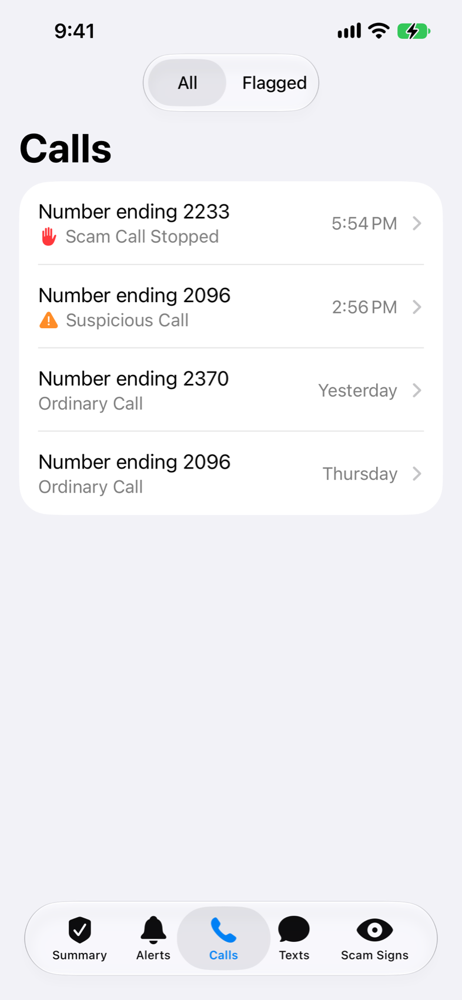
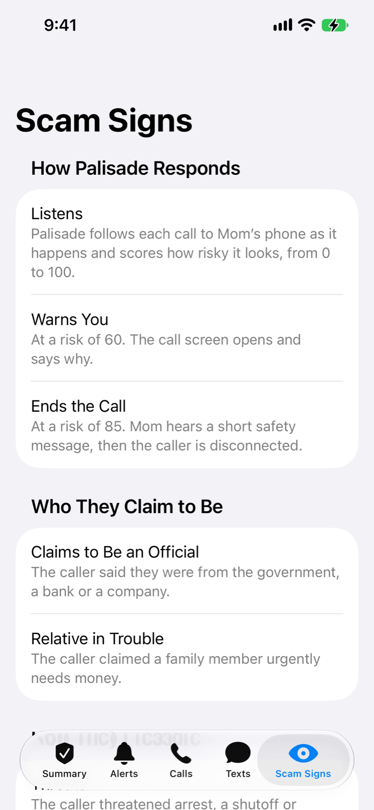
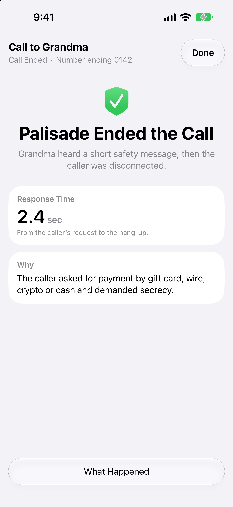
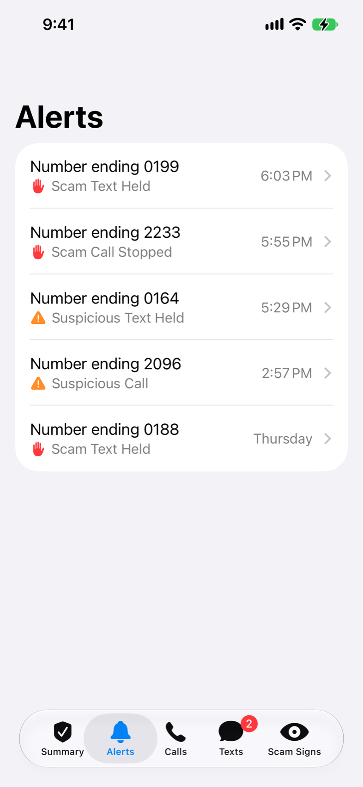

# Palisade for iPhone

The caregiver's app. It shows the call in progress (risk dial, warning signs, live
transcript), takes over the screen when Palisade ends a scam call, keeps a list of
recent calls, and holds the texts Palisade stopped until the caregiver releases or
discards them. It has five pages behind a tab bar: Summary, Alerts, Calls, Texts
and Scam Signs. The protected person needs no app at all.

It is a SwiftUI app for iOS 17 and later. It has one dependency, Auth0's library for
signing in, which Xcode fetches by itself as a Swift package. It reads the Palisade
server's `GET /events` feed, its `GET /calls` list and, for texts, `GET /messages` and
`GET /gateway/messages`.

## Status

- Builds with Xcode 27 for the simulator and for a device. The project file was written
  by hand and Xcode takes it as is.
- Run in the iPhone 17 simulator (iOS 27) against a Palisade server playing demo calls, on
  2026-10-07 and again on 2026-10-08: Home with real call history, a scam call from first
  word to "Palisade ended the call", the summary, Settings, the demo menu, an ordinary
  call that closes by itself, hiding and reopening a live call, and dark mode.
- Restyled on 2026-10-08 to the system's own look (grouped backgrounds, system type,
  cards at the system's corner radius), then redrawn the way Health draws its cards:
  black and gray text, the system's green, orange and red, and color used once per
  card, on a small label. No tinted boxes, pills or icons on colored discs.
- The same day it gained a "Call" button on Palisade's warning and the caller's flagged
  phrases marked in the transcript.
- Settings has an Appearance choice: Automatic (follow the phone), Light or Dark.
- Looked at on 2026-10-08 with sample data: the "Ringing" state, a call that ends after
  a warning with no hang-up, and an accessibility text size. The layouts hold; at that
  text size the header's status line is cut short.
- On 2026-10-09 the motion was gone through frame by frame on a recorded demo call and
  fixed at three moments: a call opening, Palisade's warning arriving, and Palisade ending
  the call. The same day the dial was redrawn around the level's name, Home and "What
  happened" became system lists, the call screen's header got the system's own buttons,
  and flagged phrases a rounded highlighter. All of it was checked in the iPhone 17e
  simulator in light and dark, with Reduce Motion on, and at an accessibility text size.
- On 2026-10-10 the look was gone over again, this time side by side with Apple's own
  Health, Messages and Settings on the same iOS. Buttons became the system's blue,
  recent calls one list, labels title case, and several things that were said twice are
  said once (see "Screens"). Checked the same way, and on a recorded demo call.
- Later on 2026-10-10 the app, until then one screen, got the system's tab bar and
  three pages, a bar above the tabs for a call whose screen has been put away, and a
  Version row in Settings. Checked in the iPhone 17e simulator in light and dark, at a
  large text size, with Reduce Motion on, and by walking a recorded demo call through
  every page.
- Renamed from Shield to Palisade on 2026-10-10, with a new icon: three folded stakes
  drawn in to a point like a shield. The icon was checked on a simulator's Home Screen
  in its default, dark, clear and tinted looks.
- Sign-in with Auth0 was added on 2026-10-10, for a server that asks for one
  (`docs/auth0-sign-in.md`, part E). Checked in a simulator against a practice server
  with sign-in on and the real Auth0 account: the app opened Auth0's page and showed
  Auth0's answer, and the new screens were looked at in light, in dark and at a large
  text size. A token-only server was run through as before, with a demo call. **A whole
  sign-in has not been made yet**: the Auth0 account was not finished that day.
- Texts, on 2026-10-10. Nabil built text protection on a branch from the app's first
  commit (a Texts tab, a review screen, a paste checker, a banner). Merged into main, his
  screens were rebuilt in the look the app has now, and two things were added at the
  user's request: an Alerts page, and, in place of the banner, a count on the Texts
  tab, a buzz, and a "Texts to Review" section on Summary. Checked in a simulator made
  for the job, in light, in dark and at an accessibility text size, with sample data and
  against a practice server fed made-up texts: a scam text arriving on Summary, released
  and discarded from the app, a text arriving behind the call screen, a relaunch. **No
  real text has gone through it**: that needs the server's text protection switched on
  (`deploy/README.md`).
- **Not yet installed on a real iPhone.** That needs an Apple ID in Xcode; see below.
- Not yet looked at: iPhones smaller than the 17e.

## Screens

From the iPhone 17e simulator, with sample data.

| Summary | Calls | Scam Signs |
|---|---|---|
|  |  |  |

| Call in progress | Palisade ended the call | What happened |
|---|---|---|
|  |  |  |

| Texts | A held text | Alerts |
|---|---|---|
|  |  |  |

More: Summary with texts to review ([screens/text-live-alert.png](screens/text-live-alert.png)),
a text after it was released ([screens/text-review-queued.png](screens/text-review-queued.png)),
and the call screen left alone while a scam text arrives behind it
([screens/text-alert-active-call.png](screens/text-alert-active-call.png)).

Dark mode: [screens/live-call-dark.png](screens/live-call-dark.png).

The tab bar is the system's own, which on iOS 26 and later is the glass one. Settings
is behind the gear on Summary.

The "Call" button only appears once the protected person's phone number is in the app's
Settings. In the transcript, the caller's words that matched one of Palisade's rules are
set in bold, and highlighted once the call looks suspicious. A demo call says "Demo
Call" wherever a real call shows the caller's number.

Summary shows the three newest calls, and Calls every call the server still keeps (its
newest 50), with a control to show only the ones Palisade warned about or ended. Each row
leads with the caller, written "Number ending 2233" (the server masks numbers to their
last four digits), says what came of the call under it, and ends with when it came in:
the time if that was today, then "Yesterday", the day of the week, or the date. At
large text sizes the day moves under the rest of the row.

Texts starts with a card like Summary's: whose texts, how their protection stands in a
word ("Protected", "Forwarding Paused", "Not Set Up"), and one line saying which number
is protected. Under it, the texts waiting for a decision ("Needs Review"), the ones that
have gone through ("Recent"), and the ones the caregiver pasted in to check ("Checked by
You", from the button at the top of the page). A row is a call's row: the sender as
"Number ending 0199", what came of the text, and when.

A held text opens on a page of its own: what Palisade made of it, the sender's whole
number, the text itself, the warning signs, the server's advice, and "Release to
<name>" and "Discard" pinned at the bottom. Each asks once before it acts, because
neither can be undone. A link in the text cannot be tapped. The text is fetched when its
page opens and dropped when the page is left or the app goes behind another one, and it
is gone from the server after 24 hours whatever happens. A text with an attachment can
only be discarded.

When Palisade holds a text while the app is open, the phone buzzes once, the Texts tab
shows how many held texts have not been looked at, and Summary lists them under "Texts
to Review". Nothing is drawn over the screen for it, and a call screen is left alone.

Alerts is one list, newest first, of everything Palisade stepped into: a call it
warned about or ended, a text it held, a text it could not get delivered. A row opens the
call's summary or the text. It says what happened at the time ("Scam Text Held"),
whatever was decided afterwards.

Scam Signs says what Palisade does about a risky call and lists everything it listens
for, in the order a scam call tends to go. The two risk numbers on that page are the
server's own thresholds. When the server is set to record what it would do without
doing it (`DRY_RUN_ACTIONS=true`), the page says practice mode is on.

The dial says how the call looks in words. The small number in its opening is the risk
score out of 100 that the words come from. The dial arrives with the first words of the
call: while the phone is ringing there is nothing for it to say.

Palisade's warning card says why it warned, and has the "Call" button. How the call looks
is left to the dial above it.

With no calls yet, Summary and Calls say so and, if the server offers demo calls, have
a "Start a Demo Call" button. When the app cannot reach the server, Summary's card has
an "Open Settings" button.

A server can ask each caregiver to sign in (`docs/auth0-sign-in.md`). The app finds that
out from the server, so there is nothing to switch on. Summary's card then says "Not
Signed In" and has a "Sign In" button, which opens Auth0's page in the system's sign-in
sheet. Settings gets an Account section, with the email and "Sign Out", in place of the
Access Token field. Someone who signs in and is not on the server's list sees "No Access"
with the server's reason, and no calls. Signing out empties the list of calls at once.

The call screen can be put away with the arrow in its header. The call then stays one
tap off on every page, in a bar above the tab bar that says how it is going (iOS 26.1
and later; before that, an "Open the Call" button on Summary). When Palisade warns or
ends a call, the call screen comes back by itself, and the phone buzzes. The transcript
keeps up with the call until you scroll up to reread, and picks up again when you
scroll back down (iOS 18 and later).

### How it looks

Screens are the system's grouped lists and cards, with black and gray text. Blue is for
what can be tapped. Green, orange and red each report a state (protected, suspicious,
scam) and are used for nothing else: once per card, on its small label, and on the dial
and the chart line. A label that only names what its card holds is gray.

Headings, labels, buttons and status words are in title case, as in Apple's own apps
("Scam Call Stopped", "What Happened"). Complete sentences are written as sentences.

### How it moves

There are three timings, in `Support/Theme.swift` (`Motion`), and nothing bounces. What
is leaving clears before its replacement arrives. A card that arrives between things
already on screen unfolds while they move out of its way. The call screen slides the
whole height of the screen, so that put away it leaves nothing at the bottom. With
Reduce Motion on, the call screen fades in where it would slide, and digits and words
cross-fade.

## Run it in the simulator

1. Install Xcode from the Mac App Store. Installing it is not enough: it also needs its
   system components and the iOS simulator (an 8 GB download). Open Xcode once and
   accept both, or do it from a terminal:
   ```bash
   sudo xcode-select -s /Applications/Xcode.app/Contents/Developer
   sudo xcodebuild -license accept
   xcodebuild -runFirstLaunch        # asks for your Mac password
   xcodebuild -downloadPlatform iOS
   ```
2. Start the server with demo calls allowed (from the repo root):
   ```bash
   DEMO_MODE=true uvicorn main:app --port 8000 --timeout-graceful-shutdown 2
   ```
   A server that was already running before `DEMO_MODE` was set has to be restarted,
   or the app shows no play button.
3. Open `ios/Shield.xcodeproj`, pick an iPhone simulator, press Run.
4. The app connects to `http://localhost:8000` by default. Tap the play button at the
   top of Summary (or "Start a Demo Call", while the list is empty) and pick a scam call.
   The call screen opens by itself.

To point the app at another server without touching Settings, pass launch arguments:
`-serverURL http://localhost:8001`. `-seniorPhone +14045550100` does the same for the
phone number behind the "Call" button.

Every screen also has an Xcode preview with sample data (`Support/Previews.swift`),
so the UI can be worked on with no server running. A debug build shows the same sample
screens on a simulator or phone with the launch argument `-sample <name>`: `home`,
`home-empty`, `home-offline`, `home-call`, `calls`, `signs`, `ringing`, `calm`,
`watchful`, `suspicious`, `warned-over`, `ended` or `detail`. For texts: `texts`,
`texts-paused`, `texts-empty`, `texts-off`, `text-held`, `text-released`,
`text-delivered`, `alerts` and `home-texts`; a decision on a sample text changes
it, so Release and Discard can be tried with no server. Three more are a server
that asks for a sign-in: `home-signed-in`, `home-signed-out` and `home-refused`; open
Settings on them to see the Account section. `-appearance light` or `-appearance dark`
sets the appearance for that launch.

## Run it on your iPhone

1. Xcode, Settings, Accounts: sign in with your Apple ID. A free account is enough.
2. In the project's Signing & Capabilities tab, choose your team. If Xcode complains
   about the bundle identifier, change `com.progsu.shield` to something of your own.
3. Plug the phone in, select it as the run destination, press Run. The first time,
   turn on Developer Mode on the phone when asked, then trust the developer profile
   under Settings, General, VPN & Device Management.
4. In the app's Settings, enter the server's public address (the ngrok hostname) and,
   if the server has `EVENTS_TOKEN` set, the token. A server that asks for a sign-in
   takes no token: tap "Sign In" on Summary.

With a free account the app stops opening after 7 days (run it again from Xcode) and
cannot receive push notifications, so keep it open during a demo.

## Code

```
Shield/
  ShieldApp.swift            entry point
  Model/                     ShieldEvent (feed), LiveCall (call state), CallSummary, Flag,
                             GatewayMessage (a text sent to the protected number),
                             MessageSummary (a text that was only checked)
  Services/ShieldAPI.swift   HTTP + the event feed
  Services/ShieldStore.swift app state: connection, sign-in, current call, history, texts
  Services/SignIn.swift      the caregiver's sign-in with Auth0, kept in the Keychain
  Views/                     RootView (pages under the call screen), MainTabs (tab bar),
                             HomeView (Summary), AlertsView, CallsView, TextsView,
                             TextDetailView, CheckTextView, SignsView, CallDetailView,
                             LiveCallView, SettingsView, SignInButton, RiskDial, FlagViews,
                             TranscriptView
  Support/                   Theme, Platform (iOS/macOS differences), SampleData, Previews
Shield-Info.plist            allows plain http to a local server
```

The project, the folder and the types keep the app's first name, Shield. The name
people see is the target's Display Name. `Assets.xcassets/AppIcon.appiconset` holds
the icon three times: as it is by default, with nothing behind the stakes for the Home
Screen's dark look (the system draws the tile), and in gray for the tinted look (the
system colors it). With only the first, iOS 27 leaves the icon a white tile in the
dark, clear and tinted looks.

`ios/Tests/ShieldStoreGatewayTests.swift` checks the store's handling of texts (the buzz
for a text just held, the count, what a replayed event must not do) against a stand-in
server, with the real store and models. `bash tools/test_ios_gateway.sh` runs it; it
needs no simulator and sends nothing.

`LiveCall.apply(_:)` is the one place where feed events become screen state. Demo
calls say "Demo Call" everywhere and are left out of Summary's counts.
`Support/Theme.swift` holds the colors, the three timings, and the app's few button
and card styles.
